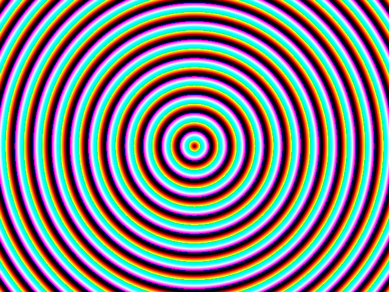

# constructive/destructive frequencies

this makes my walls move towards me

Play it: https://shadergator.hackclub.com/ships/8

## Files

| File | Contents |
| --- | --- |
| `image.glsl` | The code of the Image tab. |
| `shader.json` | The whole shader in Shadertoy's export format. |
| `screenshot.png` | The screenshot. |

## Paste it into Shadertoy

1. Open https://www.shadertoy.com/new and sign in.
2. Select all the code in the Image tab, and paste the contents of `image.glsl` over it.
3. Press the play button below the code, or Alt+Enter, to compile it.

## Licence

MIT. See `LICENSE`.
